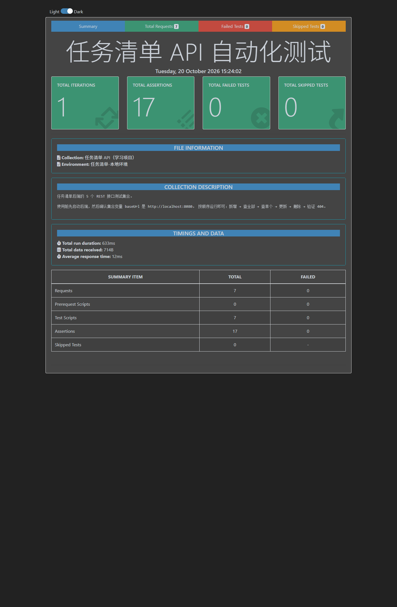

# Spring Boot 任务清单接口 · 学习记录

> 这是一个**学习型仓库**，不是一次性交付的项目。
> 记录我从零实现一个「任务清单 CRUD 后端」的完整过程：需求 → 选型 → 建表 → 写接口 → 本地跑通 → 部署 → 复盘。

[](https://adoptium.net/)
[](https://spring.io/projects/spring-boot)
[](https://www.mysql.com/)

---

## 这个仓库记录了什么

| # | 内容 | 文档 | 说明 |
|---|---|---|---|
| 1 | 原始需求 | [docs/01-原始需求.md](docs/01-原始需求.md) | 一开始到底要做什么、边界在哪 |
| 2 | 技术选型 | [docs/02-技术选型.md](docs/02-技术选型.md) | 为什么选 Spring Boot + JPA + MySQL |
| 3 | 数据库设计、建表 SQL | [docs/03-数据库设计.md](docs/03-数据库设计.md) | 字段、类型、索引、SQL 全在这 |
| 4 | 接口文档 | [docs/04-接口文档.md](docs/04-接口文档.md) | 5 个接口的请求方式、路径、入参出参 |
| 5 | 本地运行步骤 | [docs/05-本地运行.md](docs/05-本地运行.md) | 傻瓜式：建库 → 启动 → 调通 |
| 6 | 服务器部署流程、踩坑记录 | [docs/06-部署与踩坑.md](docs/06-部署与踩坑.md) | 上云步骤 + 我实际踩过的坑 |
| 7 | 学习总结与思考 | [docs/07-学习总结.md](docs/07-学习总结.md) | 学到什么、哪里还没懂、下一步 |

测试记录（真实请求/响应）见 [docs/api-test-record.md](docs/api-test-record.md)。

> 附录：[Git / GitHub 上传教程（傻瓜版）](docs/08-git上传教程.md) —— 哪些文件该传、哪些不该传、目录怎么组织。

---

## 项目做了什么

一个只有后端、没有前端的任务清单服务，提供 5 个标准 REST 接口：

| 功能 | 方法 | 路径 | 成功状态码 |
|---|---|---|---|
| 新增任务 | `POST` | `/api/tasks` | `201 Created` |
| 查询全部 | `GET` | `/api/tasks` | `200 OK` |
| 查询单个 | `GET` | `/api/tasks/{id}` | `200 OK` |
| 更新任务 | `PUT` | `/api/tasks/{id}` | `200 OK` |
| 删除任务 | `DELETE` | `/api/tasks/{id}` | `204 No Content` |

任务状态只能是：`TODO`（待办）、`IN_PROGRESS`（进行中）、`DONE`（已完成）。

详细请求参数和响应示例：[docs/04-接口文档.md](docs/04-接口文档.md)

---

## 技术栈

| 层 | 选择 | 版本 |
|---|---|---|
| 语言 | Java | 17+（实测 26） |
| 框架 | Spring Boot | 3.5.16 |
| 持久层 | Spring Data JPA / Hibernate | 6.6.53 |
| 数据库 | MySQL | 5.7.29（兼容 8.0） |
| 构建 | Maven Wrapper | 3.9.11 |
| 接口测试 | Postman / Newman + Node.js | 6.2.3 / 24.x |

选型理由和放弃的方案：[docs/02-技术选型.md](docs/02-技术选型.md)

---

## 30 秒跑起来

```bash
# 1. 建库建表（会提示输入 MySQL root 密码）
mysql -u root -p -e "source sql/01_create_database.sql"
mysql -u root -p task_manager -e "source sql/02_create_table.sql"

# 2. 启动（Windows 用 mvnw.cmd，macOS/Linux 用 ./mvnw）
./mvnw spring-boot:run

# 3. 验证
curl http://localhost:8080/api/tasks
```

看到 `[]`（空库）或任务数组就成功了。完整步骤和常见报错：[docs/05-本地运行.md](docs/05-本地运行.md)

---

## 目录结构

```text
.
├─ README.md                    仓库首页（你正在看）
├─ pom.xml                      Maven 依赖
├─ mvnw / mvnw.cmd / .mvn/      Maven Wrapper，不用单独装 Maven
├─ src/main/java/com/example/taskmanager/
│  ├─ TaskManagerApplication.java    启动类
│  ├─ controller/TaskController.java 5 个 REST 接口
│  ├─ service/TaskService.java       业务逻辑
│  ├─ repository/TaskRepository.java JPA 数据访问
│  ├─ entity/                        Task、TaskStatus
│  ├─ dto/                           请求 / 响应对象
│  └─ exception/                     自定义异常 + 全局异常处理
├─ src/main/resources/application.yml  数据库配置（不硬编码）
├─ sql/                         建库、建表脚本
├─ postman/                     Postman 集合与环境变量
├─ scripts/                     自动测试脚本
└─ docs/                        学习记录（01 ~ 07）+ 测试证据
```

---

## 测试结果

| 套件 | 结果 |
|---|---|
| Node.js 冒烟测试（9 个场景） | ✅ 9/9 |
| Postman 集合（Newman 执行） | ✅ 7 请求 / 17 断言 / 0 失败 |



---

## 关于本仓库

- 这是**个人学习记录**，代码以「能跑通、能讲清楚」为目标，不是生产级方案。
- 配置里的 `TaskApp@123456` 只是本地示例密码，**不要**用于任何线上环境。
- 欢迎交流，但请按学习用途看待。

## License

MIT
