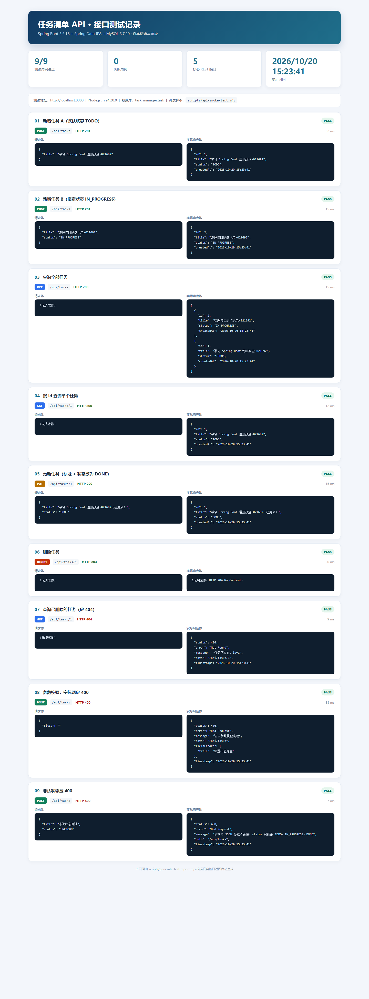

# 任务清单 API 接口测试记录

- **项目**：任务清单后端（Task Manager API）
- **测试日期**：2026-10-20
- **测试结论**：**通过**。5 个核心 REST 接口全部可用，正常场景与 400/404 异常场景均符合预期。
- **测试方式**：Node.js 自动冒烟测试 + Postman 集合（Newman 命令行执行）
- **测试数据**：测试结束后已自动清理，`task` 表当前为 0 行；重新执行脚本会自动生成新数据。

---

## 1. 测试环境

| 项目 | 版本 / 说明 |
|---|---|
| 操作系统 | Windows 11 |
| JDK | Java 26.0.2.1 |
| 后端框架 | Spring Boot 3.5.16 |
| ORM | Spring Data JPA / Hibernate 6.6.53.Final |
| 数据库 | MySQL 5.7.29（`task_manager` 库） |
| 构建工具 | Maven Wrapper 3.9.11 |
| 接口测试 | Node.js 24.20.0 + Newman 6.2.3 + Postman Collection v2.1 |
| 服务地址 | `http://localhost:8080` |

> Hibernate 启动时会提示 MySQL 5.7 已不在官方支持范围内，这是警告而非错误。本项目的 5 个接口在 MySQL 5.7.29 上已实际验证通过。

---

## 2. 测试结论总览

| 测试套件 | 请求数 | 断言数 | 通过 | 失败 |
|---|---:|---:|---:|---:|
| Node.js 冒烟测试（9 个场景） | 9 | 9 个场景 | 9 | 0 |
| Postman 集合（Newman 执行） | 7 | 17 | 17 | 0 |

对应截图：

**Postman / Newman 测试报告（7 个请求、17 个断言、0 失败）**


**5 个接口的真实请求与响应明细**



---

## 3. 测试用例明细

| 序号 | 测试场景 | 方法与路径 | 期望结果 | 实际结果 | 判定 |
|---:|---|---|---|---|---|
| 1 | 新增任务 A，不传状态 | `POST /api/tasks` | 201，状态默认 `TODO` | 201，返回 id=1、`TODO`、createdAt | ✅ |
| 2 | 新增任务 B，指定进行中 | `POST /api/tasks` | 201，状态 `IN_PROGRESS` | 201，返回 id=2、`IN_PROGRESS` | ✅ |
| 3 | 查询全部 | `GET /api/tasks` | 200，数组包含 A、B | 200，返回 2 条，按创建时间倒序 | ✅ |
| 4 | 查询单个 | `GET /api/tasks/1` | 200，返回 id=1 的任务 | 200，字段正确 | ✅ |
| 5 | 更新标题和状态 | `PUT /api/tasks/1` | 200，状态变为 `DONE` | 200，标题和状态均已更新 | ✅ |
| 6 | 删除任务 | `DELETE /api/tasks/1` | 204，无响应体 | 204，无响应体 | ✅ |
| 7 | 查询已删除任务 | `GET /api/tasks/1` | 404，返回“任务不存在” | 404，错误结构正确 | ✅ |
| 8 | 参数校验：空标题 | `POST /api/tasks` | 400，指出 title 错误 | 400，`fieldErrors.title=标题不能为空` | ✅ |
| 9 | 非法状态值 | `POST /api/tasks` | 400，提示合法状态 | 400，提示只能使用三个枚举值 | ✅ |

---

## 4. 关键接口的真实请求与响应

以下内容来自 `docs/evidence/api-test-results.json`，不是手写示意图。

### 4.1 新增任务（POST /api/tasks）

**请求：**

```http
POST /api/tasks HTTP/1.1
Host: localhost:8080
Content-Type: application/json

{
  "title": "学习 Spring Boot 增删改查-021692"
}
```

**响应：**

```http
HTTP/1.1 201 Created
Location: http://localhost:8080/api/tasks/1
Content-Type: application/json

{
  "id": 1,
  "title": "学习 Spring Boot 增删改查-021692",
  "status": "TODO",
  "createdAt": "2026-10-20 15:23:41"
}
```

**验证点：**

- 不传 `status` 时自动使用 `TODO`
- 返回数据库自增 id
- `Location` 响应头指向新资源
- `createdAt` 自动生成，格式为 `yyyy-MM-dd HH:mm:ss`

---

### 4.2 查询全部任务（GET /api/tasks）

**请求：**

```http
GET /api/tasks HTTP/1.1
Host: localhost:8080
```

**响应：**

```http
HTTP/1.1 200 OK
Content-Type: application/json

[
  {
    "id": 2,
    "title": "整理接口测试记录-021692",
    "status": "IN_PROGRESS",
    "createdAt": "2026-10-20 15:23:41"
  },
  {
    "id": 1,
    "title": "学习 Spring Boot 增删改查-021692",
    "status": "TODO",
    "createdAt": "2026-10-20 15:23:41"
  }
]
```

**验证点：**

- 返回 JSON 数组
- 按 `created_at` 倒序排列，最新任务在前
- 列表同时包含刚创建的两条任务

---

### 4.3 查询单个任务（GET /api/tasks/1）

**请求：**

```http
GET /api/tasks/1 HTTP/1.1
Host: localhost:8080
```

**响应：**

```http
HTTP/1.1 200 OK
Content-Type: application/json

{
  "id": 1,
  "title": "学习 Spring Boot 增删改查-021692",
  "status": "TODO",
  "createdAt": "2026-10-20 15:23:41"
}
```

---

### 4.4 更新任务（PUT /api/tasks/1）

**请求：**

```http
PUT /api/tasks/1 HTTP/1.1
Host: localhost:8080
Content-Type: application/json

{
  "title": "学习 Spring Boot 增删改查-021692（已更新）",
  "status": "DONE"
}
```

**响应：**

```http
HTTP/1.1 200 OK
Content-Type: application/json

{
  "id": 1,
  "title": "学习 Spring Boot 增删改查-021692（已更新）",
  "status": "DONE",
  "createdAt": "2026-10-20 15:23:41"
}
```

**验证点：**

- `title` 和 `status` 都更新成功
- `createdAt` 没有被改变
- PUT 是整体更新，两个字段都必须提交

---

### 4.5 删除任务（DELETE /api/tasks/1）

**请求：**

```http
DELETE /api/tasks/1 HTTP/1.1
Host: localhost:8080
```

**响应：**

```http
HTTP/1.1 204 No Content
```

**验证点：**

- 返回 204，没有响应体
- 再查询同一个 id 返回 404，说明数据确实被删除

---

### 4.6 异常场景：任务不存在（404）

**请求：**

```http
GET /api/tasks/1 HTTP/1.1
Host: localhost:8080
```

**响应：**

```http
HTTP/1.1 404 Not Found
Content-Type: application/json

{
  "status": 404,
  "error": "Not Found",
  "message": "任务不存在，id=1",
  "path": "/api/tasks/1",
  "timestamp": "2026-10-20 15:23:41"
}
```

---

### 4.7 异常场景：标题为空（400）

**请求：**

```http
POST /api/tasks HTTP/1.1
Host: localhost:8080
Content-Type: application/json

{
  "title": ""
}
```

**响应：**

```http
HTTP/1.1 400 Bad Request
Content-Type: application/json

{
  "status": 400,
  "error": "Bad Request",
  "message": "请求参数校验失败",
  "path": "/api/tasks",
  "fieldErrors": {
    "title": "标题不能为空"
  },
  "timestamp": "2026-10-20 15:23:41"
}
```

---

### 4.8 异常场景：非法状态（400）

**请求：**

```http
POST /api/tasks HTTP/1.1
Host: localhost:8080
Content-Type: application/json

{
  "title": "非法状态测试",
  "status": "UNKNOWN"
}
```

**响应：**

```http
HTTP/1.1 400 Bad Request
Content-Type: application/json

{
  "status": 400,
  "error": "Bad Request",
  "message": "请求体 JSON 格式不正确；status 只能是 TODO、IN_PROGRESS、DONE",
  "path": "/api/tasks",
  "timestamp": "2026-10-20 15:23:41"
}
```

---

## 5. Postman 自动化执行记录

**执行命令（Newman）：**

第一次使用需要先安装 Newman 和 HTML 报告插件（只需安装一次）：

```powershell
npm install --prefix .tools/newman newman newman-reporter-htmlextra
```

然后执行：

```powershell
node .tools/newman/node_modules/newman/bin/newman.js run `
  postman/Task-API.postman_collection.json `
  -e postman/Task-API.postman_environment.json `
  --reporters cli,json,htmlextra `
  --reporter-json-export docs/evidence/newman-summary.json `
  --reporter-htmlextra-export docs/evidence/newman-report.html `
  --reporter-htmlextra-title "任务清单 API 自动化测试"
```

**Newman 控制台结果：**

```text
requests:      7 executed, 0 failed
test-scripts:  7 executed, 0 failed
assertions:   17 executed, 0 failed
total run duration: 633ms
average response time: 12ms
```

**逐条结果：**

```text
01 新增任务                        201 Created     √ 状态码为 201
                                                  √ 返回完整的任务字段
                                                  √ 响应头包含 Location
02 查询全部任务                    200 OK          √ 状态码为 200
                                                  √ 返回 JSON 数组
                                                  √ 列表中包含刚新增的任务
03 查询单个任务                    200 OK          √ 状态码为 200
                                                  √ 返回指定 id 的任务
04 更新任务                        200 OK          √ 状态码为 200
                                                  √ 标题和状态都已更新
                                                  √ 创建时间保持不变
05 删除任务                        204 No Content  √ 状态码为 204
                                                  √ 删除成功时没有响应体
06 查询已删除任务（应 404）         404 Not Found   √ 状态码为 404
                                                  √ 返回统一的错误结构
07 参数校验：空标题（应 400）       400 Bad Request √ 状态码为 400
                                                  √ 返回 title 字段错误
```

**Postman 截图：**


---

## 6. 如何复现这份测试记录

### 6.1 前提

1. MySQL 已启动，已执行 `sql/01_create_database.sql` 和 `sql/02_create_table.sql`。
2. 后端已在 `http://localhost:8080` 启动。
3. 项目根目录为 `E:\project`。

### 6.2 运行 9 个场景的自动测试

```powershell
cd E:\project
node scripts/api-smoke-test.mjs
```

预期输出：

```text
✅ 01 新增任务 A（默认状态 TODO）  [HTTP 201]
✅ 02 新增任务 B（指定状态 IN_PROGRESS）  [HTTP 201]
✅ 03 查询全部任务  [HTTP 200]
✅ 04 按 id 查询单个任务  [HTTP 200]
✅ 05 更新任务（标题 + 状态改为 DONE）  [HTTP 200]
✅ 06 删除任务  [HTTP 204]
✅ 07 查询已删除的任务（应 404）  [HTTP 404]
✅ 08 参数校验：空标题应 400  [HTTP 400]
✅ 09 非法状态应 400  [HTTP 400]

测试完成：9/9 通过，0 失败
```

### 6.3 用 Postman 图形界面复现

1. 导入 `postman/Task-API.postman_collection.json` 和 `postman/Task-API.postman_environment.json`。
2. 右上角选择“任务清单-本地环境”。
3. 点击集合的 `Run`，按顺序运行全部 7 个请求。
4. 查看 `Tests` 标签页，应为 17 个断言全部通过。

### 6.4 重新生成测试详情页

```powershell
node scripts/generate-test-report.mjs
```

生成 `docs/evidence/api-test-report.html`，用浏览器打开即可查看全部请求/响应。

---

## 7. 原始证据文件

| 文件 | 内容 |
|---|---|
| `docs/evidence/api-test-results.json` | 9 个场景的完整请求、响应、耗时、通过状态 |
| `docs/evidence/api-test-report.html` | 根据真实结果生成的接口明细页 |
| `docs/evidence/newman-summary.json` | Postman/Newman 的原始运行结果 |
| `docs/evidence/newman-report.html` | Postman/Newman 可视化报告（可浏览器打开） |
| `docs/screenshots/postman-newman-report.png` | Newman 报告截图 |
| `docs/screenshots/api-test-details.png` | 9 个测试场景的请求/响应截图 |

> 说明：测试脚本使用带时间戳的标题，避免重复运行产生同名数据；测试结束后会删除自己创建的任务，所以 `task` 表当前为空是正常的。再次运行脚本即可重新生成数据。
